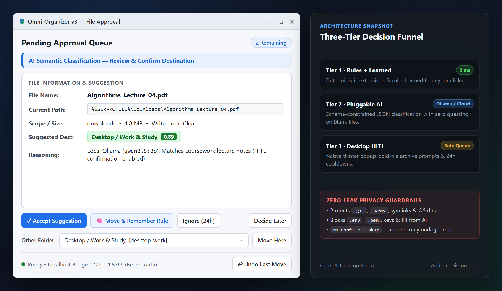
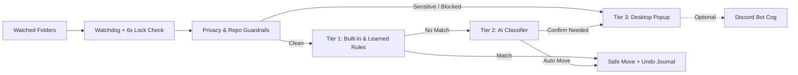

# Omni-Organizer v3

> **Stop letting AI file organizers break code repos or leak secrets to the cloud.**  
> 100% local Ollama semantic routing, zero-leak privacy guardrails, native desktop approval popup & 1-click undo — running on Windows in 3 minutes.

**English** | [繁體中文](./README.zh-TW.md) | [简体中文](./README.zh-CN.md)

[](./LICENSE)
[](https://www.python.org/)
[](#ai-providers)
[](#features)



## Features

- **Three-Tier Funnel**: Deterministic & learned rules (**Tier 1**) → pluggable AI classifier (**Tier 2**) → Human-in-the-Loop approval (**Tier 3**).
- **Privacy & Safety Guardrails**: Never moves OS folders, code repos (`.git`, `pyproject.toml`, `.venv`, etc.), symlinks, or `protected_paths`. Sensitive filenames (`.env`, `.pem`, keys, contracts) and key/PII snippets never reach AI.
- **Native Desktop Popup**: Built-in `tkinter` approval dialog (no extra GUI dependencies) with Accept, Remember Rule, Pick Folder, Ignore, and **1-Click Undo** + 24h anti-tug-of-war cooldown.
- **Age-Based Archive Proposals**: Scans cold files after configurable thresholds (e.g., 30 / 120 days) and asks for confirmation before archiving.
- **Optional Discord Extension**: Decoupled [`integrations/discord/`](./integrations/discord/README.md) Cog communicates via a loopback-only (`127.0.0.1`), Bearer-protected Bridge API.

## How It Works



## Quick Start

1. **Clone & install dependencies**
   ```powershell
   git clone https://github.com/adamf-s77/omni-organizer.git
   cd omni-organizer
   pip install -r requirements.txt
   ```
2. **Create local configs (gitignored)**
   ```powershell
   Copy-Item config\v3_settings.example.json config\v3_settings.local.json
   Copy-Item config\config.example.yaml config\config.yaml
   Copy-Item config\monitored_paths.example.json config\monitored_paths.json
   ```
   Edit `config\v3_settings.local.json` to configure your `monitored_scopes`, `destinations`, and `protected_paths`.
3. **Preview the popup UI** (safe demo, touches no files)
   ```powershell
   python src\desktop_prompt.py --demo
   ```
4. **Start the background watcher**
   - Foreground test: `python src\watcher.py`
   - Windows silent logon auto-start: `powershell -ExecutionPolicy Bypass -File scripts\install_user_task.ps1`
   - Control menu: double-click `launch_control_center.bat`

## AI Providers

Configure `"ai"` inside `config\v3_settings.local.json`:

| Mode | `provider` | Notes |
| :--- | :--- | :--- |
| **Local Offline** | `"ollama"` | Zero cloud egress (e.g., `qwen2.5:3b` at `127.0.0.1:11434`). Run `scripts\setup_local_llm.ps1` for Windows Vulkan GPU setup. |
| **Google Gemini** | `"gemini"` | Install `google-genai`, set `"api_key_env": "GEMINI_API_KEY"`, `"model": "gemini-2.5-flash"`. |
| **OpenAI-Compatible** | `"openai_compat"` | Groq, OpenRouter, LM Studio, etc. via `"base_url"`, `"model"`, and `"api_key_env"`. |
| **Rules + Popup Only** | `"none"` | Tier 1 rules + Desktop Popup without any LLM calls. |

> Set `"require_confirmation": true` under `"ai"` to require confirmation before every Tier 2 AI move.

## Optional Discord Bot & Testing

- **Discord Remote Approval (Optional)**: See [`integrations/discord/README.md`](./integrations/discord/README.md).
- **Run Unit Tests** (isolated temp dirs, zero mutations to your files):
  ```powershell
  python -m unittest discover -s tests -v
  ```

## License

[MIT](./LICENSE)
