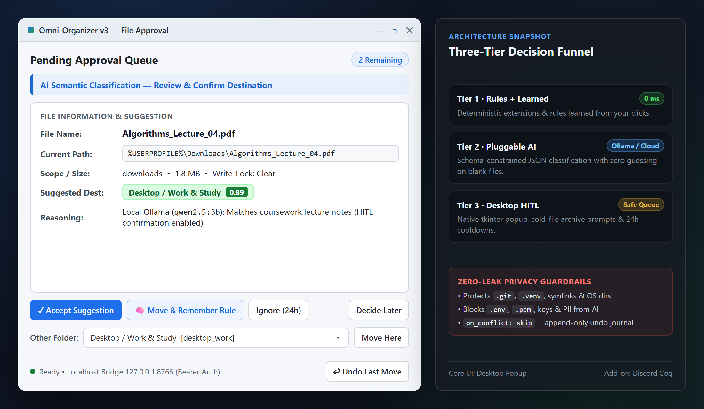
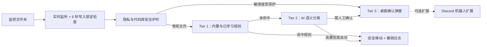

# Omni-Organizer v3

> **别再让 AI 整理工具破坏代码仓库，或把隐私文件误传云端！**  
> 100% 本地 Ollama 语义分类 ＋ 零泄露隐私护栏 ＋ 原生桌面确认弹窗与一键撤销，Windows 3 分钟快速上手。

[English](./README.md) | [繁體中文](./README.zh-TW.md) | **简体中文**

[](./LICENSE)
[](https://www.python.org/)
[](#ai-模型支持)
[](#核心功能)



## 核心功能

- **三层漏斗决策**：优先匹配零延迟确定性与学习规则（**Tier 1**）→ 交由可插拔 AI 分类器（**Tier 2**）→ 不确定或需确认的文件进入人工审核（**Tier 3**）。
- **隐私与安全护栏**：绝不移动操作系统目录、代码仓库（`.git`、`pyproject.toml`、`.venv` 等）、符号链接及自定义 `protected_paths`；敏感文件名（`.env`、`.pem`、密钥、合同）及隐私文本片段绝不发送给 AI。
- **原生桌面确认弹窗**：基于 Python 内置 `tkinter` 构建（无需额外 GUI 依赖），支持确认移动、移动并记住规则、选择其他文件夹、忽略冷却与 **一键撤销**（附带 24 小时防反复拉扯冷却机制）。
- **过期文件归档建议**：按文件停留天数阈值（如 30 / 120 天）定期扫描冷文件，先弹窗征询确认后再执行归档。
- **可选 Discord 远程扩展**：通过独立模块 [`integrations/discord/`](./integrations/discord/README.md) 与仅限本地回环（`127.0.0.1`）且带 Bearer Token 鉴权的 Bridge API 通信。

## 工作流程



## 快速开始

1. **克隆仓库并安装依赖**
   ```powershell
   git clone https://github.com/adamf-s77/omni-organizer.git
   cd omni-organizer
   pip install -r requirements.txt
   ```
2. **创建本地配置文件（已列入 gitignore）**
   ```powershell
   Copy-Item config\v3_settings.example.json config\v3_settings.local.json
   Copy-Item config\config.example.yaml config\config.yaml
   Copy-Item config\monitored_paths.example.json config\monitored_paths.json
   ```
   编辑 `config\v3_settings.local.json`，配置你的 `monitored_scopes`、`destinations` 与 `protected_paths`。
3. **预览桌面确认弹窗**（纯演示模式，不会改动任何文件）
   ```powershell
   python src\desktop_prompt.py --demo
   ```
4. **启动后台监听服务**
   - 前台测试运行：`python src\watcher.py`
   - 安装 Windows 登录自动静默后台运行：`powershell -ExecutionPolicy Bypass -File scripts\install_user_task.ps1`
   - 打开交互式控制菜单：双击 `launch_control_center.bat`

## AI 模型支持

在 `config\v3_settings.local.json` 的 `"ai"` 字段中配置模型后端：

| 模式 | `provider` | 说明 |
| :--- | :--- | :--- |
| **纯本地离线** | `"ollama"` | 零云端外传（默认搭配 `http://127.0.0.1:11434` 与 `qwen2.5:3b`）。可运行 `scripts\setup_local_llm.ps1` 配置 Windows Vulkan GPU 加速。 |
| **Google Gemini** | `"gemini"` | 安装 `google-genai`，配置 `"api_key_env": "GEMINI_API_KEY"` 与 `"model": "gemini-2.5-flash"`。 |
| **OpenAI 兼容接口** | `"openai_compat"` | 支持 Groq、OpenRouter、LM Studio 等，配置 `"base_url"`、`"model"` 与 `"api_key_env"` 即可。 |
| **纯规则＋弹窗模式** | `"none"` | 仅使用 Tier 1 规则与桌面确认弹窗，不调用任何 LLM。 |

> 若在 `"ai"` 中设置 `"require_confirmation": true`，所有 Tier 2 AI 分类建议都会先弹窗等待你确认后再移动。

## 可选 Discord 扩展与测试

- **Discord 远程审核（可选）**：请参阅 [`integrations/discord/README.md`](./integrations/discord/README.md)。
- **运行单元测试**（全程使用隔离临时目录，不会改动任何真实文件）：
  ```powershell
  python -m unittest discover -s tests -v
  ```

## 开源协议

[MIT](./LICENSE)
