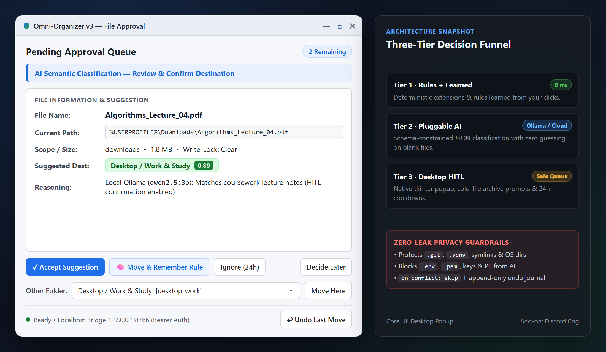
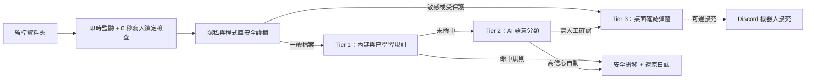

# Omni-Organizer v3

> **別再讓 AI 整理工具拆壞程式碼庫，或把私密檔案誤傳雲端！**  
> 100% 本機 Ollama 語意分類 ＋ 零外洩隱私護欄 ＋ 原生桌面確認彈窗與一鍵還原，Windows 3 分鐘快速上手。

[English](./README.md) | **繁體中文** | [简体中文](./README.zh-CN.md)

[](./LICENSE)
[](https://www.python.org/)
[](#ai-模型支援)
[](#核心功能)



## 核心功能

- **三層漏斗決策**：先走零延遲確定性與學習規則（**Tier 1**）→ 再交給可插拔 AI 分類器（**Tier 2**）→ 不確定或需確認的檔案進入人工審核（**Tier 3**）。
- **隱私與安全護欄**：絕不移動作業系統目錄、程式碼儲存庫（`.git`、`pyproject.toml`、`.venv` 等）、符號連結及自訂 `protected_paths`；含敏感檔名（`.env`、`.pem`、金鑰、合約）或私密片段的檔案絕不送入 AI。
- **原生桌面確認彈窗**：採用 Python 內建 `tkinter` 打造（無須額外 GUI 套件），支援同意搬移、搬移並記住規則、改選其他資料夾、略過冷卻與 **一鍵還原**（附帶 24 小時防拉扯冷卻機制）。
- **過期檔案歸檔建議**：依檔案停留天數門檻（如 30 / 120 天）定期掃描冷檔案，先彈窗徵詢同意後才執行歸檔。
- **可選 Discord 遠端擴充**：透過獨立模組 [`integrations/discord/`](./integrations/discord/README.md) 與僅限本機回環（`127.0.0.1`）且帶 Bearer Token 驗證的 Bridge API 溝通。

## 運作流程



## 快速開始

1. **複製專案並安裝相依套件**
   ```powershell
   git clone https://github.com/adamf-s77/omni-organizer.git
   cd omni-organizer
   pip install -r requirements.txt
   ```
2. **建立本機設定檔（已列入 gitignore）**
   ```powershell
   Copy-Item config\v3_settings.example.json config\v3_settings.local.json
   Copy-Item config\config.example.yaml config\config.yaml
   Copy-Item config\monitored_paths.example.json config\monitored_paths.json
   ```
   編輯 `config\v3_settings.local.json`，設定你的 `monitored_scopes`、`destinations` 與 `protected_paths`。
3. **預覽桌面確認彈窗**（純展示模式，不會異動任何檔案）
   ```powershell
   python src\desktop_prompt.py --demo
   ```
4. **啟動背景監聽服務**
   - 前景測試執行：`python src\watcher.py`
   - 安裝 Windows 登入自動靜默背景執行：`powershell -ExecutionPolicy Bypass -File scripts\install_user_task.ps1`
   - 開啟互動式控制選單：雙擊 `launch_control_center.bat`

## AI 模型支援

在 `config\v3_settings.local.json` 的 `"ai"` 區塊設定模型後端：

| 模式 | `provider` | 說明 |
| :--- | :--- | :--- |
| **純本機離線** | `"ollama"` | 零雲端外連（預設搭配 `http://127.0.0.1:11434` 與 `qwen2.5:3b`）。可執行 `scripts\setup_local_llm.ps1` 設定 Windows Vulkan GPU 加速。 |
| **Google Gemini** | `"gemini"` | 安裝 `google-genai`，設定 `"api_key_env": "GEMINI_API_KEY"` 與 `"model": "gemini-2.5-flash"`。 |
| **OpenAI 相容介面** | `"openai_compat"` | 支援 Groq、OpenRouter、LM Studio 等，設定 `"base_url"`、`"model"` 與 `"api_key_env"` 即可。 |
| **純規則＋彈窗模式** | `"none"` | 僅使用 Tier 1 規則與桌面確認彈窗，完全不呼叫任何 AI。 |

> 若在 `"ai"` 中設定 `"require_confirmation": true`，所有 Tier 2 AI 分類建議都會先彈窗請你確認後才搬移。

## 可選 Discord 擴充與測試

- **Discord 遠端審核（選用）**：請參閱 [`integrations/discord/README.md`](./integrations/discord/README.md)。
- **執行單元測試**（全程使用隔離暫存目錄，不會改動任何真實檔案）：
  ```powershell
  python -m unittest discover -s tests -v
  ```

## 授權條款

[MIT](./LICENSE)
